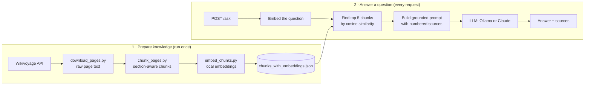

# Tenerife AI 🌋

An AI travel assistant for Tenerife, built from scratch with **Retrieval-Augmented Generation (RAG)**.

Ask a question like *"Where can I take the kids to swim near Los Cristianos?"* and it finds the most relevant parts of a Tenerife travel guide, then uses a language model to write an answer **based only on those sources**, with citations. If the answer isn't in the sources, it says so instead of making something up.

> Status: work in progress. A learning and portfolio project, built step by step.

---

## How it works

The project has two parts: preparing the knowledge in advance, and answering questions at request time.



### 1. Prepare the knowledge

| Step | Script | What it does |
|---|---|---|
| Download | `download_pages.py` | Fetches Tenerife pages from the Wikivoyage API as plain text |
| Chunk | `chunk_pages.py` | Splits pages at their section headings (*Get in*, *See*, *Eat*…) into ~1,000-character chunks, keeping page and section labels |
| Embed | `embed_chunks.py` | Turns each chunk into a vector with a local `sentence-transformers` model, so text can be searched by meaning, not keywords |

### 2. Answer a question

1. **Retrieve:** the question is embedded with the same model and compared with every chunk using cosine similarity. The 5 closest chunks are selected.
2. **Augment:** those chunks are added to the prompt as numbered sources.
3. **Generate:** the LLM answers using only those sources, cites them, and says "I don't know" when the sources don't cover the question.

---

## Tech stack

- **Python 3**
- **FastAPI + Uvicorn:** HTTP API
- **Supabase (Postgres + pgvector):** events, venues and tours with vector search
- **sentence-transformers** (`all-MiniLM-L6-v2`): local, free embeddings
- **NumPy:** cosine-similarity search
- **Ollama** (`llama3.2`): local LLM, the default
- **Anthropic Claude API:** optional hosted LLM
- **Wikivoyage API:** travel guide data (CC BY-SA)
- **pytest:** unit tests

---

## Getting started

### Prerequisites

- Python 3.10+
- [Ollama](https://ollama.com) installed and running (for the free, local option)

### Setup

```bash
git clone https://github.com/<your-username>/tenerife-ai.git
cd tenerife-ai

python3 -m venv .venv
source .venv/bin/activate
pip install -r requirements.txt

ollama pull llama3.2
```

### Configuration

Create a `.env` file in the project root:

```
# "ollama" (default, free and local) or "claude"
LLM_PROVIDER=ollama

# Only needed when LLM_PROVIDER=claude
ANTHROPIC_API_KEY=sk-ant-...
```

### Build the knowledge base

All commands run from the project folder.

```bash
python -m ingest.download_pages   # Wikivoyage pages -> data/pages/
python -m ingest.chunk_pages      # section-aware chunks -> data/chunks.json
python -m ingest.embed_chunks     # embeddings -> data/chunks_with_embeddings.json
python -m ingest.sync_supabase    # events, venues, tours -> ai_documents (pgvector)
```

### Run the API

```bash
uvicorn app.main:app --reload
```

Open **http://127.0.0.1:8000/docs** for the interactive API docs, or use curl:

```bash
curl -X POST http://127.0.0.1:8000/ask \
  -H "Content-Type: application/json" \
  -d '{"question": "How do I get to Teide?"}'
```

Example response shape:

```json
{
  "answer": "…",
  "sources": [
    { "title": "Teide National Park", "section": "Get in", "score": 0.71 }
  ]
}
```

### Use it from the terminal

```bash
python -m app.cli "how do I get to Teide?"                 # full answer
python -m app.cli --search "where can I take the kids to swim?"  # retrieval only
```

### Run the tests

```bash
pytest
```

The tests replace the LLM, database and embedding model with fakes, so they run in under a second.

---

## Project structure

```
tenerife-ai/
├── app/                      # the application
│   ├── main.py               # FastAPI routes (POST /ask, GET /health)
│   ├── rag.py                # orchestration: retrieve → prompt → generate
│   ├── config.py             # settings and paths, read from .env
│   ├── embeddings.py         # the one place that knows the embedding model
│   ├── llm.py                # Ollama / Claude behind one generate() function
│   ├── prompts.py            # system prompt and source formatting
│   ├── cli.py                # ask questions from the terminal
│   └── retrievers/
│       ├── wikivoyage.py     # search guide chunks (NumPy)
│       └── app_data.py       # search events/places/tours (pgvector + SQL filters)
├── ingest/                   # scripts that build the knowledge base
│   ├── download_pages.py
│   ├── chunk_pages.py
│   ├── embed_chunks.py
│   └── sync_supabase.py
├── tests/
│   └── test_rag.py
├── requirements.txt
└── .env                      # local secrets (not committed)
```

---

## Design decisions

- **RAG instead of fine-tuning.** The model doesn't need retraining. Updating the knowledge means re-running the scripts, and answers can cite their sources.
- **Built without an LLM framework first.** Retrieval, prompting and generation are written in plain Python so each step is visible and easy to debug. A framework (LangGraph) is planned only for the agent stage, where it adds real value.
- **Section-aware chunking.** Splitting at Wikivoyage's own headings keeps each chunk about one topic, which improves retrieval.
- **Local first.** Embeddings and the default LLM run locally, so the project costs nothing to run. The LLM can be switched to Claude with one environment variable.
- **Grounded prompt.** The model is told to use only the sources, cite them and admit when it doesn't know, which reduces hallucinations.
- **Prepared data vs live data.** Stable knowledge (travel guides) is prepared in advance for RAG. Fast-changing data (weather, buses, events) will be fetched live through tools.

---

## Roadmap

- [x] Wikivoyage data pipeline (download → chunk → embed)
- [x] Semantic retrieval with cosine similarity
- [x] Grounded answers with source citations
- [x] FastAPI endpoint, swappable LLM (Ollama / Claude)
- [ ] **Evaluation:** test questions with expected sources, plus a scoring script to measure retrieval and answer quality
- [ ] Better retrieval: stronger embedding model, hybrid search (BM25 + vectors), re-ranking
- [x] Events, venues and tours from Supabase with pgvector, plus SQL filters
- [x] Modular structure (retrievers, LLM providers, prompts) with unit tests
- [ ] Move Wikivoyage chunks into pgvector too
- [ ] Least-privilege database role and separate schema for AI data
- [ ] Agent tools: weather (AEMET), buses (TITSA GTFS), live Wikivoyage search
- [ ] Simple chat web page
- [ ] Docker setup

---

## Data and licence

Travel content comes from [Wikivoyage](https://en.wikivoyage.org), available under the [Creative Commons Attribution-ShareAlike licence](https://creativecommons.org/licenses/by-sa/4.0/).

---

## Author

**Imre Mocsari**, Senior Ruby on Rails engineer exploring applied AI.
[LinkedIn](https://www.linkedin.com/in/imocsari) · [GitHub](https://github.com/imocsari)
